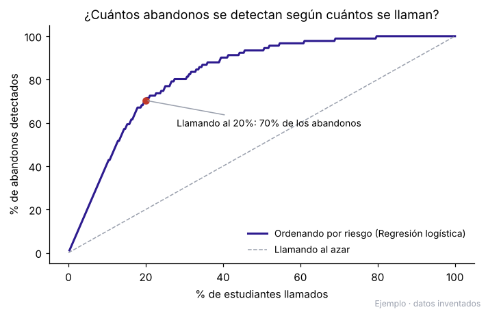
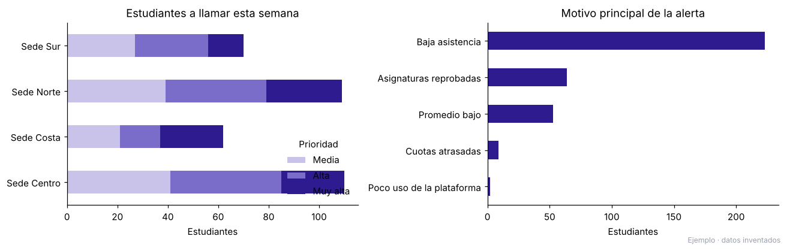
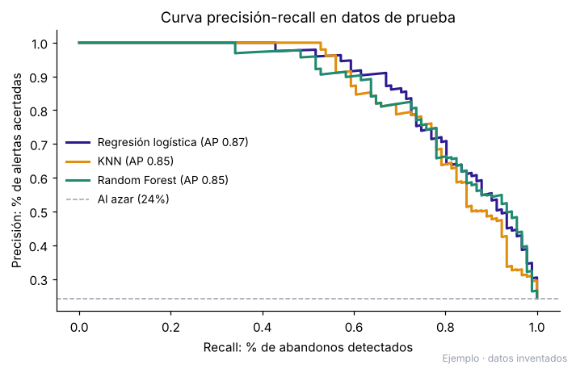

# Alerta temprana de abandono estudiantil

[](https://colab.research.google.com/github/CesarGuarecuco/alerta-temprana-estudiantil/blob/main/alerta_temprana.ipynb) [](https://nbviewer.org/github/CesarGuarecuco/alerta-temprana-estudiantil/blob/main/alerta_temprana.ipynb) 

> **Demostración con datos inventados.** La base de 1.500 estudiantes, las 4 sedes y las carreras son ficticias y se generan con `generar_datos.py`. Ningún dato corresponde a personas ni instituciones reales.

## El problema

Una institución con varias sedes pierde estudiantes durante el primer semestre y se entera tarde, cuando ya dejaron de asistir. Las coordinaciones tienen la asistencia, las notas y los pagos, pero repartidos en planillas distintas y sin una forma de saber a quién llamar primero.

## La solución

Un modelo de machine learning ordena a todos los estudiantes por riesgo de abandono con los datos de las primeras 8 semanas, y entrega cada semana un Excel con una hoja por sede: quién está en alerta, con qué prioridad y por qué motivo.



## Resultado (en los datos de demostración)

- Llamando al **20%** de los estudiantes con mayor riesgo se detecta el **70%** de los que iban a abandonar.
- El **85%** de esas llamadas va a estudiantes que efectivamente iban a abandonar; llamando al azar sería el 24%.
- Cada alerta trae su motivo principal (baja asistencia, asignaturas reprobadas, promedio bajo, cuotas atrasadas...), para que la conversación con el estudiante sea concreta.



## Modelos comparados

Se compararon tres modelos con validación cruzada estratificada y ajuste de hiperparámetros (GridSearchCV), midiendo el área bajo la curva precisión-recall (AP), que no se infla con el desbalance de clases:

| Modelo | AP | ROC AUC | Abandonos detectados llamando al 20% |
| --- | --- | --- | --- |
| **Regresión logística** | **0,865** | **0,929** | **70%** |
| Random Forest | 0,854 | 0,926 | 67% |
| KNN (41 vecinos, ponderado por distancia) | 0,846 | 0,908 | 67% |

Se eligió la regresión logística: rinde igual o mejor y se puede explicar, algo necesario para que una coordinación confíe en la lista.



## Qué hay en el repositorio

| Archivo | Contenido |
| --- | --- |
| `generar_datos.py` | Genera la base inventada con una semilla fija (reproducible) |
| `datos/estudiantes_inventados.csv` | La base generada |
| `alerta_temprana.ipynb` | Exploración, comparación de modelos, umbral de alerta y lista semanal |
| `salidas/a_quien_llamar.xlsx` | Lista de ejemplo: resumen y una hoja por sede |

## Cómo ejecutarlo

```bash
pip install -r requirements.txt
python generar_datos.py
jupyter notebook alerta_temprana.ipynb
```

O ábrelo en Colab con el botón de arriba.

## Cómo se adapta a una institución real

1. Se conectan las fuentes que ya existen (asistencia, notas, pagos, plataforma) en una base central.
2. Se entrena el modelo con los semestres anteriores de la propia institución.
3. La lista se genera sola cada semana y cada coordinación ve solo su sede.
4. Se registra el resultado de cada llamada para medir si las acciones bajan el abandono.

---

¿Necesitas algo así con los datos de tu institución? [Sivax Intelligence](https://sivax-intelligent.netlify.app/) · [sivax.contacto@gmail.com](mailto:sivax.contacto@gmail.com)
